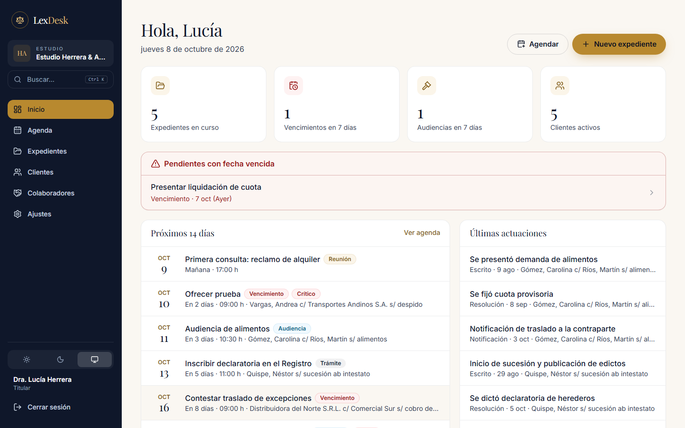
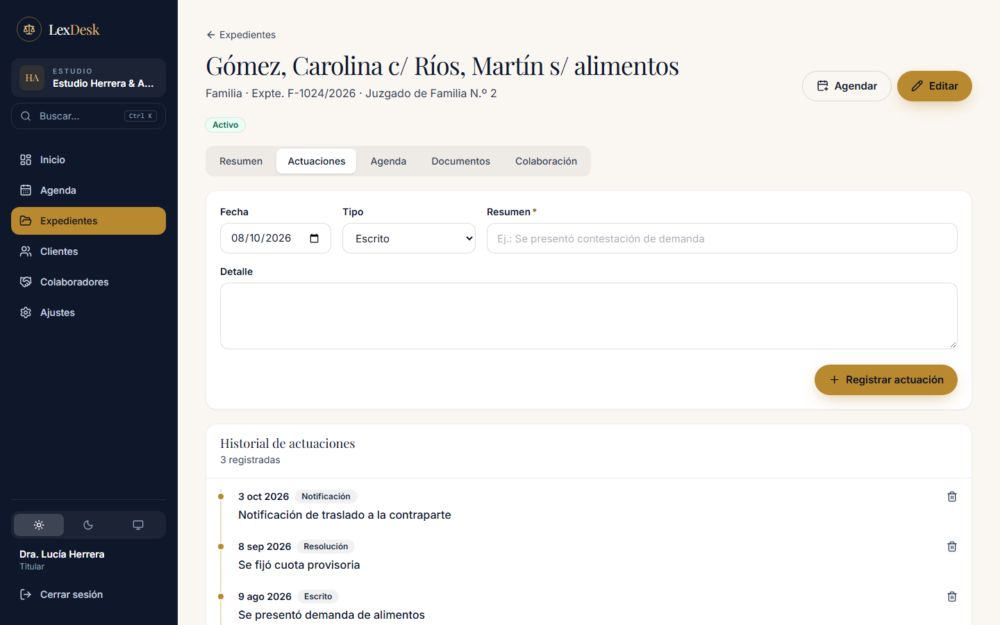
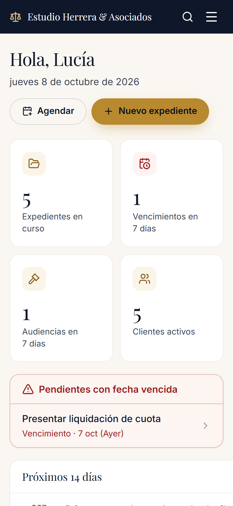
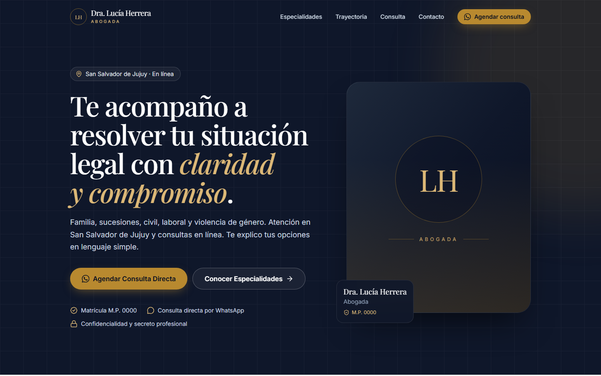
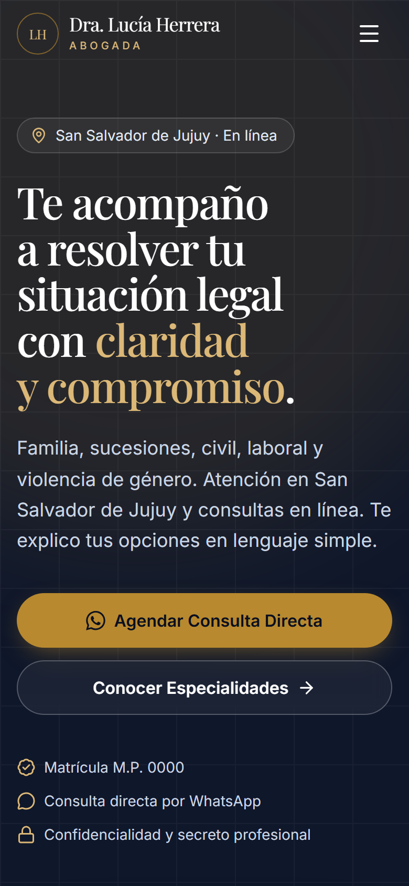
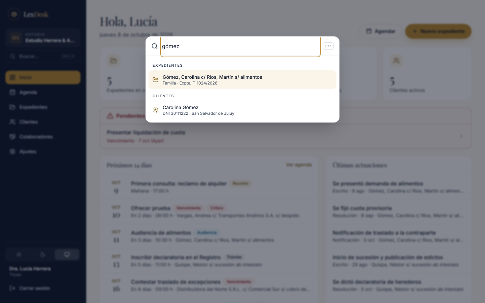
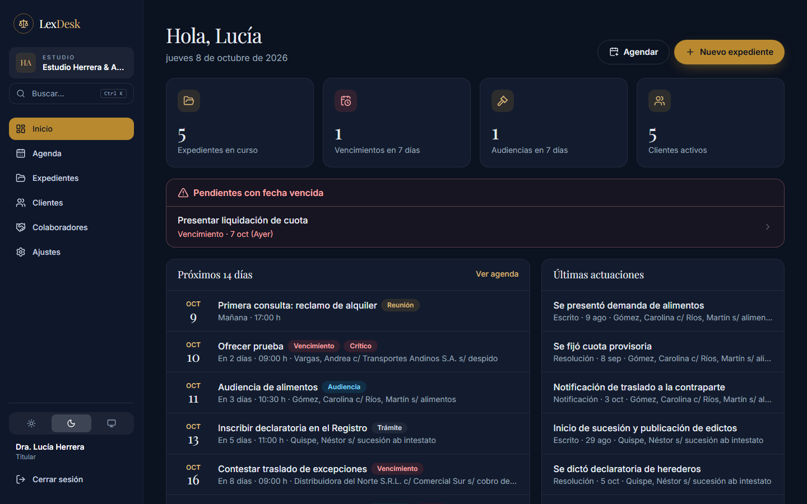
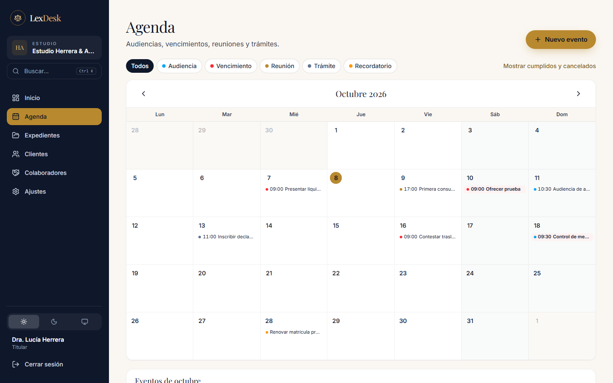
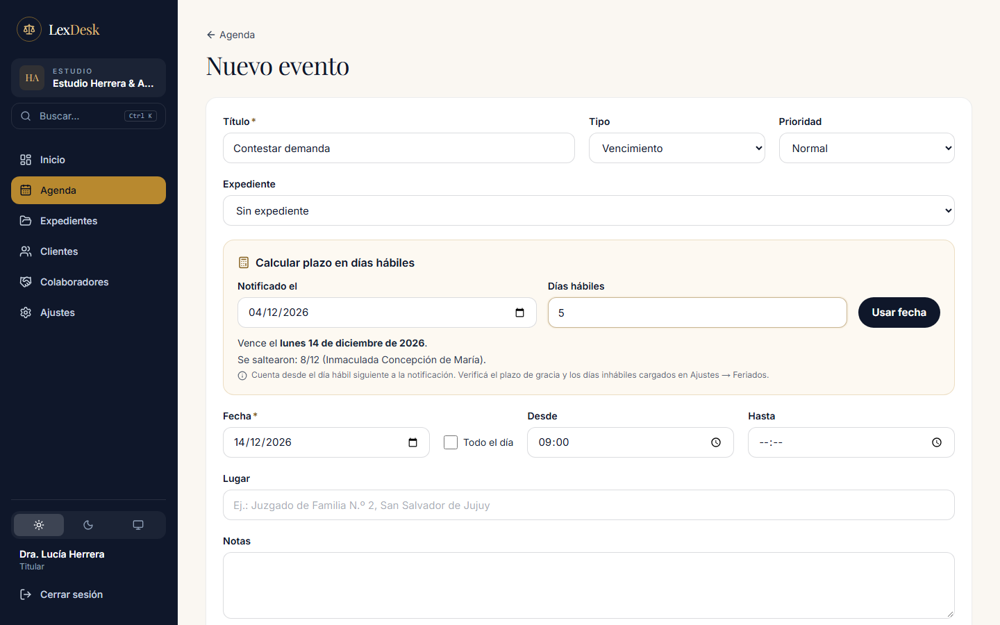
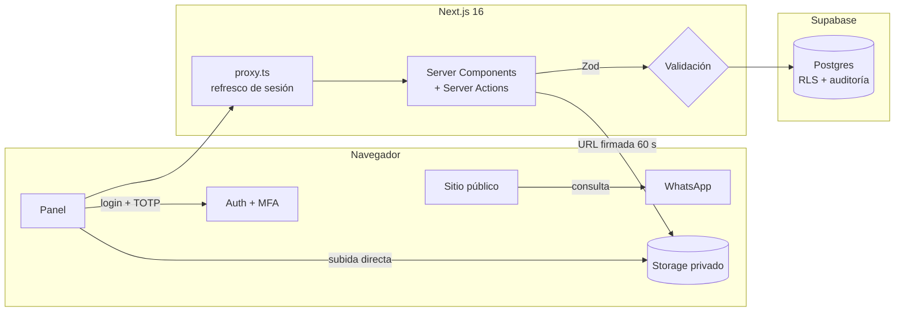

<div align="center">

# ⚖️ LexDesk

**Gestión de estudios jurídicos para abogados independientes de Argentina.**
Sitio público de captación de consultas + panel privado con expedientes, agenda de plazos procesales,
documentos y colaboración segura entre colegas.


</div>

<p align="center">
  
</p>

## ✨ Funcionalidades

### Sitio público (captación)
- Landing *mobile-first* con áreas de práctica, sedes, mapa y formulario que arma la consulta y la abre en **WhatsApp**.
- SEO técnico: metadata dinámica, imagen OpenGraph generada, `sitemap.xml`, `robots.txt` y datos estructurados **`LegalService` (JSON-LD)**.
- Política de privacidad conforme a la **Ley 25.326** y consentimiento explícito en el formulario.
- Perfil del estudio inyectado por variable de entorno: **el repositorio no contiene datos personales reales**.

### Panel de gestión

<p align="center">
  
  
</p>

| Módulo | Qué resuelve |
|---|---|
| **Inicio** | Vencimientos y audiencias de los próximos 14 días, pendientes vencidos resaltados, actividad reciente. |
| **Expedientes** | Carátula, número, juzgado, contraparte, estado, historial de actuaciones y documentos. |
| **Agenda** | Calendario mensual por tipo de evento y **cálculo de plazos en días hábiles** (saltea fines de semana, feriados y ferias judiciales). |
| **Documentos** | Almacenamiento privado, URLs firmadas de 60 s y registro de cada descarga. |
| **Colaboración** | Compartir un expediente puntual con un colega (lectura o comentarios, con vencimiento opcional). |
| **Auditoría** | Quién creó, modificó, borró, vio o descargó qué y cuándo. |
| **Multi-estudio** | Cada estudio con sus datos aislados; un colega puede colaborar con varios estudios y cambiar entre ellos. |
| **Paleta de comandos** | `Ctrl + K`: buscar expedientes y clientes, crear un expediente, cliente o vencimiento y navegar sin mouse. |
| **Modo oscuro** | Claro, oscuro o según el sistema, con colores semánticos y contraste AA. |
| **WhatsApp** | Botón directo en la ficha del cliente: normaliza teléfonos argentinos (0, 15, 549) al formato internacional. |

<p align="center">
  
  
</p>

<p align="center">
  
  
</p>

<p align="center">
  
  
</p>

## 🔐 Seguridad por diseño

El sistema guarda información amparada por el secreto profesional y **datos sensibles** (Ley 25.326), así que la seguridad se diseñó en capas:

- **Aislamiento multi-estudio (multi-tenant):** cada fila pertenece a un estudio; RLS y triggers garantizan que ningún estudio vea ni referencie datos de otro.
- **Autorización en la base de datos (RLS):** cada tabla tiene políticas de Row Level Security. Aunque la aplicación tuviera un error, un colaborador no puede leer lo que no se le compartió.
- **2FA obligatorio (TOTP):** sin nivel de autenticación `aal2` la base no devuelve datos.
- **Sin registro público:** los usuarios solo existen por invitación; los roles viven en membresías que solo modifica el servidor.
- **Expedientes sensibles:** no se pueden compartir, y marcarlos revoca los accesos existentes (trigger en Postgres).
- **Mínimo privilegio:** los colaboradores nunca ven datos de clientes ni la agenda; la clave de servicio solo existe en el servidor (`server-only`).
- **Encabezados:** CSP estricta, HSTS, `X-Frame-Options: DENY`, `nosniff`, `Permissions-Policy`.
- **Sesiones:** tokens de 15 min con rotación, cierre por inactividad y "cerrar sesión en todos los dispositivos".

Detalle completo en [`docs/SEGURIDAD.md`](docs/SEGURIDAD.md).

## 🏗️ Arquitectura



| Capa | Tecnología |
|---|---|
| Frontend | Next.js 16 (App Router, Server Components, Server Actions), React 19, TypeScript estricto |
| UI | Tailwind CSS v4, Radix UI, Framer Motion, Lucide |
| Datos | Supabase: Postgres con RLS, Auth con MFA, Storage privado |
| Validación | Zod (en el servidor y en el navegador), React Hook Form |
| Calidad | Playwright (E2E + unitarias), pgTAP (pruebas de seguridad de la base), ESLint |

Más detalle en [`docs/ARQUITECTURA.md`](docs/ARQUITECTURA.md).

## 🧪 Pruebas

| Suite | Qué verifica |
|---|---|
| `npm run test:db` | **39 pruebas pgTAP** de RLS: aislamiento entre estudios, anónimo, titular sin/con 2FA, colaborador en varios estudios, accesos vencidos y revocados, borrado en cascada. |
| `npx playwright test` | Flujo completo: login, alta obligatoria de 2FA, expedientes, documentos, agenda, invitación de un colega por email, comentarios, revocación y aislamiento entre dos estudios. Sitio público en móvil y escritorio. Cómputo de plazos procesales. |

## 🚀 Correr el proyecto

Requisitos: Node 20+, Docker Desktop.

```bash
npm install
npx supabase start                 # Postgres, Auth, Storage y Mailpit locales
cp .env.example .env.local         # completar con los valores que imprime `supabase start`
npm run db:seed-demo              # datos ficticios + usuaria demo@lexdesk.demo / Demo-LexDesk-2026
npm run dev                        # http://localhost:3000  ·  panel: /acceso
```

Emails de prueba (invitaciones, recuperación): http://127.0.0.1:54324

## 📁 Estructura

```
app/
  (sitio público)        page.tsx, privacidad/, opengraph-image.tsx, robots.ts, sitemap.ts
  acceso/                login, verificación TOTP, alta de 2FA, recuperación de contraseña
  panel/                 inicio, agenda/, expedientes/, clientes/, colaboradores/, ajustes/
components/              UI del sitio y del panel
lib/
  auth/                  sesión AAL2, políticas de contraseña, redirecciones seguras
  panel/                 esquemas Zod, cómputo de plazos, etiquetas
  supabase/              clientes server/browser/admin y tipos generados
supabase/
  migrations/            esquema, RLS, triggers de auditoría y Storage
  tests/                 pruebas pgTAP de seguridad
  templates/             emails de autenticación en español
tests/                   Playwright (E2E y unitarias)
docs/                    arquitectura y estrategia de seguridad
```

## 🗺️ Roadmap

- [x] Multi-estudio (SaaS): datos aislados por organización.
- [x] Modo oscuro, paleta de comandos (Ctrl+K) y acciones rápidas globales.
- [ ] Vista Kanban de expedientes por etapa procesal y vista semanal de agenda.
- [ ] Honorarios y gastos por expediente.
- [ ] Alertas de vencimientos (24 h y 3 días antes) por email.
- [ ] Vista previa de documentos.
- [ ] Integraciones: novedades de expedientes (PJN / poderes judiciales provinciales), plantillas `.docx`, recordatorios por WhatsApp.

## 👤 Autor

Desarrollado por [**@titonet89**](https://github.com/titonet89).
